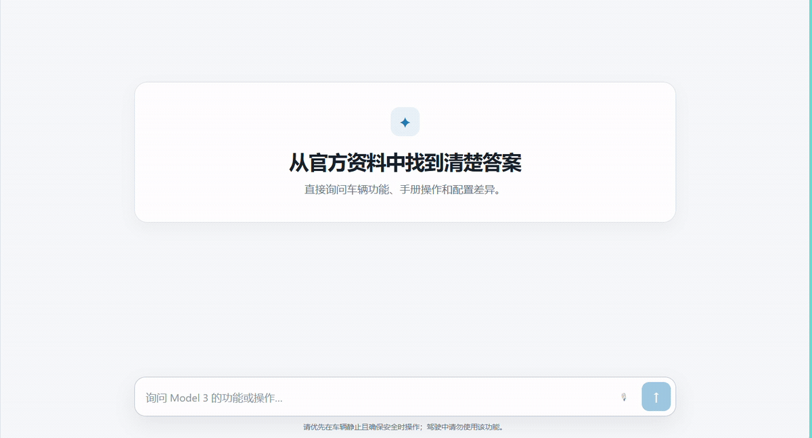

# 车书 Agent

**车书 Agent 是一个能够理解车辆专业问题、检索可靠资料、支持连续追问，并提供有价值回答的汽车知识助手。**

以车辆手册和官方资料为主要依据，将车辆问题转化为检索任务，通过工具调用查找相关内容，回答并提供引用，减少用户翻阅手册、查找配置和理解专业描述的成本。



## 能解决什么问题？

- **车辆功能问答**：解释功能是什么、如何操作、使用条件及限制
- **手册检索**：检索手册相关章节及内容，回答引用对应资料
- **配置差异对比**：对比不同配置的功能差异，准确说明相同点及不同点
- **查看回答依据**：通过引用查看对应的资料章节与来源。

## 交互方式

- **文字问答**：输入车辆问题；支持结合上下文连续追问，也允许主动切换话题。
- **语音输入**：点击麦克风打开语音菜单；转写内容可编辑，确认后再发送。
- **语音回复**：可自行设置打开“语音自动回复”，自动播放默认关闭，可在语音菜单中开启，偏好保存在当前浏览器。
- **对话管理**：支持重命名、置顶或取消置顶；会话历史可保存。
- **引用查看**：点击回答下方的引用，查看资料章节和来源，辅助核查重要信息。


## 安装与运行

### 环境要求

- Python 3.10+
- Node.js 22.12+
- DeepSeek API Key

以下命令以 Windows PowerShell 为例。

### 1. git clone

```powershell
git clone https://github.com/starliu2358-png/cheshu-ai.git
cd cheshu-ai
```

### 2. 安装后端依赖

```powershell
python -m venv .venv
.\.venv\Scripts\python.exe -m pip install -e ".[dev]"
```

### 3. 配置模型

```powershell
Copy-Item .env.example .env
notepad .env
```

如果已有 `.env`，直接编辑，不要覆盖自己的配置。主要设置如下：

```dotenv
DEEPSEEK_API_KEY=your_deepseek_api_key_here
DEEPSEEK_BASE_URL=https://api.deepseek.com
DEEPSEEK_MODEL=deepseek-flash

CHESHU_EXECUTION_MODE=agent
CHESHU_RETRIEVAL_MODE=bm25
```

填写自己的 API Key。

### 4. 启动后端

在仓库根目录执行，并保持终端运行：

```powershell
.\.venv\Scripts\python.exe -m uvicorn cockpit_agent.api:app --host 127.0.0.1 --port 8000
```

### 5. 启动前端

另开一个终端，先进入本地 `cheshu-ai` 仓库根目录，再执行：

```powershell
cd frontend
npm ci
npm run dev -- --host 127.0.0.1
```

打开[车书网页](http://127.0.0.1:5173)。

## 架构设计

前端：React + TypeScript + Vite

├─ 前端
└─ 后端
   ├─ API 服务
   ├─ Agent ：LLM + Tool Calling + Agent Loop
   ├─ RAG 检索与证据校验
   └─ 会话状态与持久化

### Agent

- API 层：FastAPI 接收问题、处理会话和反馈请求。
- Agent ：DeepSeek 作为 LLM，OpenAI Agents SDK 编排模型与工具循环，Python 实现工具、预算限制和输出校验。
- RAG 检索层：检索车辆资料，为 Agent 提供回答证据。
- 会话状态与持久化

## 仓库结构

```text
cheshu-ai/                       
├─ frontend/                     # React + TypeScript + Vite 前端
├─ src/cockpit_agent/            # 车书后端 Python 包
│  ├─ api.py                     # FastAPI 问答与会话
│  └─ vehicle_book/              # Agent、RAG、证据校验与会话逻辑
│     ├─ agent_loop.py           # 模型与工具循环
│     ├─ retriever.py            # BM25 检索
│     ├─ hybrid_retriever.py     # 向量检索
│     ├─ session.py              # 结构化会话状态
│     └─ sqlite_session.py       # 会话持久化
├─ data/                         # 知识资料与评测数据
│  ├─ knowledge/                 # 车辆知识正文
│  ├─ registry/                  # 车型、文档、版本等元数据
│  ├─ eval/                      # 检索和回答评测数据集
│  └─ baselines/                 # 回归评测基线
├─ scripts/                      # 索引构建与评测脚本
├─ tests/                        # 后端自动化测试
├─ docs/                         # 素材
│  └─ assets/                    # README 
│     └─ cheshu-demo.gif         # 素材
├─ outputs/                      # 评测结果与本地运行产物
├─ .env.example                  # 环境变量配置示例
└─ pyproject.toml                # Python 依赖及测试配置
```
## 当前范围与局限

### 支持的车型

目前整理了 Tesla Model 3 中国市场以下配置的部分资料：

- 后轮驱动版
- 长续航后轮驱动版
- 长续航全轮驱动版
- 高性能全轮驱动版

**暂不支持其他品牌、其他车型的知识问答，也不保证覆盖上述车型的全部功能、年份和软件版本。**

## 版本与后续迭代

当前版本：[V1.0.0 Release](https://github.com/starliu2358-png/cheshu-ai/releases/tag/v1.0.0)。

后续优先围绕汽车专业问答质量改进：

- 提高配置差异问答准确性。
- 优化连续追问、回答精简和引用表达。
- 充知识覆盖，再逐步支持更多车型。

> 当前为 V1.0 版本，主要覆盖 Tesla Model 3 中国市场的部分车型与知识内容。非 Tesla 官方产品，回答可能出错，请核查重要信息；驾驶中请勿操作。
>
